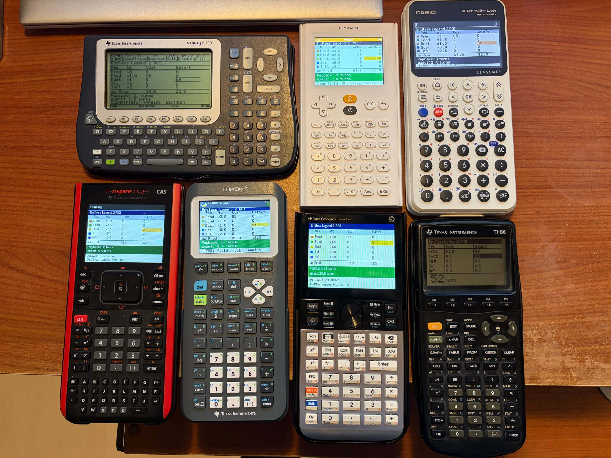

# Endless Legend 2 ROI Calculator

A small payback calculator for **Endless Legend 2**, running on seven graphing calculators.



## What it does

In Endless Legend 2 you constantly decide whether a building, upgrade or deal is worth it. This tool answers one question:

> **How many turns until this pays for itself?**

You enter the **cost** and the **gain per turn** for each resource. The program converts everything into one common value using weights and shows:

- the weighted totals, expressed in Industry ("as Prod")
- the **payback time in whole turns** (rounded up)
- the exact payback time with one decimal

The screen updates live while you type. If there is no gain at all, the result bar turns red and shows "no payback".

## How it calculates

Each resource has a weight, its value in Dust:

| Resource | Weight | Meaning |
|---|---|---|
| Prod (Industry) | 3.0 | 1 Industry = 3 Dust |
| Food | 2.0 | 1 Industry = 1.5 Food |
| Dust | 1.0 | reference value |
| Sci (Science) | 6.0 | 1 Industry = 0.5 Science |
| Infl (Influence) | 2.5 | 1 Influence = 2.5 Dust |

```
payback = sum(cost × weight) / sum(gain × weight)
```

The result is rounded up, because a turn that has started counts as a full turn.

The weights are my personal estimate. They are defined at the top of every program, so you can easily change them to match your own play style.

## Supported calculators

| Calculator | Language | File |
|---|---|---|
| NumWorks | Python (kandinsky, ion) | `1_NumWorks/roi.py` |
| TI-84 Evo / TI-84 Plus CE Python | Python (ti_draw, ti_system) | `2_TI-84_Evo/ROIG.py` |
| HP Prime G2 | HP PPL | `3_HP_Prime/EL2ROI.txt` |
| TI-Nspire CX II | Python (ti_draw, ti_system) | `4_TI-Nspire/el2roi.py` |
| TI-86 | Z80 assembly | `5_TI-86/EL2ROIG.86p` |
| Casio Graph Math+ | Python (casioplot) | `6_Casio_Graph_Math/el2roi.py` |
| TI Voyage 200 | TI-BASIC | `7_TI_Voyage_200/el2roi.v2p` |

## Controls

All versions work the same way: a table with one row per resource and two input columns, Cost and Gain per turn. Move between the fields, type a number, and the result updates immediately.

| Calculator | Move | Empty field | Reset all | Quit |
|---|---|---|---|---|
| NumWorks | arrows, OK, EXE | Backspace | Shift, then Backspace | Back |
| TI-84 Evo | arrows, enter | clear | del | mode |
| HP Prime | arrows, Enter | Esc | Del | Home |
| TI-Nspire CX II | arrows, enter | clear | – | esc |
| TI-86 | arrows, ENTER | CLEAR | DEL | EXIT |
| Casio Graph Math+ | arrows, OK, EXE | DEL | ×10^x | AC |
| TI Voyage 200 | arrows, ENTER | CLEAR | ← (backspace) | ESC |

On the TI-Nspire, del deletes the last character instead of resetting everything.

## Installation

- **NumWorks:** Connect the calculator via USB and upload the script with the online workshop at [my.numworks.com](https://my.numworks.com). Run it from the Python app.
- **TI-84 Evo / TI-84 Plus CE Python:** Send `ROIG.py` with TI Connect CE. It is converted into a Python program automatically. Run it from the Python app.
- **HP Prime:** Create a new program named `EL2ROI` in the Connectivity Kit, paste the contents of `EL2ROI.txt`, and send it to the calculator. Start it from the program catalog.
- **TI-Nspire CX II:** Open `el2roi.py` in the TI-Nspire CX Student Software (or paste it into a new Python editor), save it as a `.tns` document, and transfer it. Run it from the document.
- **TI-86:** Send `EL2ROIG.86p` with TI Connect or TiLP and a link cable. Start it with `Asm(EL2ROIG)`.
- **Casio Graph Math+:** Connect via USB. The calculator appears as a drive. Copy `el2roi.py` onto it and run it from the Python app.
- **TI Voyage 200:** Send `el2roi.v2p` with TI Connect or TiLP and a link cable. Start it with `el2roi()`.

## About this project

All versions share one common interface on purpose, so they are easy to compare and maintain. The downside is that they do not use the native strengths of each calculator, such as soft-key menus on the HP Prime and TI-86 or toolbars on the Voyage 200. A more "native" version for some of the calculators may follow.

The programs were written with a lot of help from an AI assistant. I am using this project to relearn programming (I learned BASIC, Pascal and Java a long time ago) and am currently rebuilding the TI-84 version in Python myself.

Feedback, bug reports and ports to other calculators are welcome.

## License

Released under the [MIT License](LICENSE).
